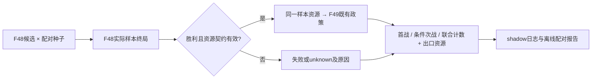

# 最小F48联合评估方案（设计，未实现）

目标是在同一批F48方案样本上比较F48→F49联合结局，并说明第一战出口资源；第一版只记shadow，保持现有题面/排序/C1/C2/SL/用药策略。本文不授权实施，也不改变已有B2连战行为。

## 复用边界

已有生产链是`withDoubleBossStart`→`fightSample`→`continuationInput`→`continuousBossResult`，不是尚未实现的独立两概率相乘。G1a source `bca06096b08b1e9bf0e11fda3e1f87fe4d83ec07`已经提供`continuous-boss-result-v1`：同样本资源、首战/条件次战/联合原始计数，校准与联合S未知；每候选最多3条有界trace。B2/B3日志已有consumer，接口的完整自然验收仍未过。

最小改动只补**现有输出的资源统计与可比性**，不新增机制、核心评分、F49模型或未来路线。若当前预算没有既有完整样本，记缺口，不因shadow另加模拟预算/worker；不重测旧历史或重复已跑模拟。

## 样本和资源身份

每条F48合法方案保留原`candidate_key`（含药槽/目标/执行顺序），基于同一输入使用同一`sample_seed`集合。记录代码提交、实际运行知识指纹、SL尝试、当前局/层/回合、候选输入SHA、求解政策和预算。F49 boss/随机种子采用既有历史分布与`sampleSeed`映射，不能读取本局未到达的实际后场身份；配对方案使用相同后场变体和外生随机流。未选方案永远是模拟，不登记实际支持。

每个样本要分开以下端点：

1. F48刚胜时的资源：HP/maxHP、占用药槽的`slot+id/key`、已消耗药槽、剩余复活对象/次数和来源、已建模开场充能。只取该样本真实返回状态。
2. 奖励/过场之后：未知奖励、拾取、治疗、生成药、永久资源变化均显式unknown，不默认把第一端点当现实第二端点。既有模型未覆盖的充能/临时增益也不得默认为0或完整恢复。
3. 模拟F49入场：应用已有学习者确认的限定开场效果，保存扣除前后与来源证据ID；不重复扣实盘或SL恢复后已发生的开场损失。已有`openingHpLoss`、`firstResources`、`secondEntry`必须连同限制一起读。
4. F49结局：win/died/capped/timeUp/unknown，另记出口资源和是否用复活。保持“资源持有”“实际使用”“首战存活”“联合模拟结果”“本局实盘结果”不同字段，不由组件齐备推导功能有效。

物理药槽不能仅按药名汇总：重复瓶、被动复活、替换/新增槽均可能破坏简单相减。旧`drunkKeys`/`revives`是已建模子集，未表示的资源写缺失原因；不凭名称使用次数构造spent清单。最终接口需要原知识owner确认每种跨战资源的作用范围，缺的保持unknown。



## 比较口径

沿用G1a原始三个分母：首战胜数/原计划样本数；次战胜数/首战胜样本数（有缺资源或未完成时保留该分母、value为null，另列完整数）；联合胜数/原计划样本数。完整性不达标时G1a原`value=null`及reason保持，不能只挑成功子集给完整胜率。没有首战胜样本时条件次战unknown，保留原接口联合null约定与原计数，不自动补零。

每方案至少同时呈现首战胜、首战胜后HP分布（n、p10/p50/p90、min）、占用药槽组合分布、复活剩余分布、已知开场损失、次战缺失原因、联合原始胜数/分母。用条件分布说明“高首胜但出口资源差”，不以平均HP替代联合率。原最多3条trace只能证明字段流向，不能代表样本总体分布。

方案间只在**相同输入/后场变体/政策/完整配对种子**上比较：记录胜负差向量、配对均值差与Monte Carlo标准误、成对完整n、未匹配n和unknown数。MC区间仅描述冻结模型抽样误差，不是生产校准或真实胜率区间。C2提前淘汰造成不同前缀样本时，保留原停止规则；共同比较覆盖不足记unknown，不把早停候选当失败，也不为了填满表改变C2。

不使用联合S，不把单战Platt施于联合结果，不把旧double-boss资源价值曲线当概率校准。F49按学习者异议标`low_trust/unknown`，三个Boss的数量闸已达而质量未过；生产与冻结模型输入不一致是额外边界。shadow中的统计优先序只能是诊断字段，不能回流现有win/HP排序、题面或SL判官。

## 最小日志契约草案

这是未来字段草案，所有null均为unknown占位，不是新增实测结果。

```json
{
  "schema": "f48-joint-shadow-v1",
  "mode": "shadow",
  "delivered": false,
  "candidate_key": "<original-key>",
  "input_sha256": "<frozen-input>",
  "sample_seed_manifest_sha256": "<paired-seeds>",
  "continuous": "<existing-continuous-boss-result-v1>",
  "exit_resources": {
    "scope": "F48-winning-samples",
    "n": null,
    "hp": {"p10": null, "p50": null, "p90": null},
    "potion_slot_states": null,
    "remaining_revive_states": null,
    "opening_charge_states": null,
    "unknown": ["unobserved-transition-rewards", "unmodelled-resource-state"]
  },
  "paired_comparison": {
    "reference": "<existing-candidate-key>",
    "complete_pairs": null,
    "missing_pairs": null,
    "delta_joint_raw": null,
    "mc_se": null
  },
  "trust": {
    "F49": "low_trust",
    "production_calibration": "unknown",
    "joint_calibration": "unknown",
    "joint_S": "unknown"
  },
  "failure": null
}
```

若须保存逐样本外置明细，使用有界压缩artifact和manifest；原decision行保留聚合与少量确定trace。归档沿现有10局report钩子，不增定时器、模型或自然观察器。失败也保留输入和结构错误引用，不输出凭据或未脱敏原环境。

## 0332和实施验收依赖

- **可先做**：本报告、字段契约、原始计数及错误引用的设计；不需新对局或模拟。
- **需要原0332 owner先交付**：完整失败样本的seed/input/最后资源/首战结算分支，根因定位、固定回归和实际main/live发布验收。C1可继续安全退让，但完整联合比较仍unknown。不能静默丢坏样本、以新鲜资源重启第二场、下调正HP或300门槛。
- **未来shadow实现的固定测试**：逐样本资源优于均值的反例；重复药槽与已用复活不恢复；已知开场扣除一次；首战无胜/未完成/缺资源/非正HP；F49capped/timeUp；不同候选共种子与部分C2前缀；其他角色/非适用进阶等价。只使用既有学习者确认机制的固定数据。
- **未来发布与自然验收**：原ops按实际改动性质分类，单独发布/如改变行为单独编号、双通知和精确组合宿主。G1a真正自然资源消费、整局shadow覆盖和转on准入由Claude另行指派，本报告不宣称通过。
- **仍需独立证据**：奖励后到次战可行动端点的映射、当前生产F49模型和联合率校准、资源策略改选的真实收益。不会因为接口齐备或样本数增加自动完成。

建议下一项最小派活先等原0332的真实修复交付，再实现上述shadow诊断。无须现在选择血量/药价/SL阈值；本轮到报告为止。
