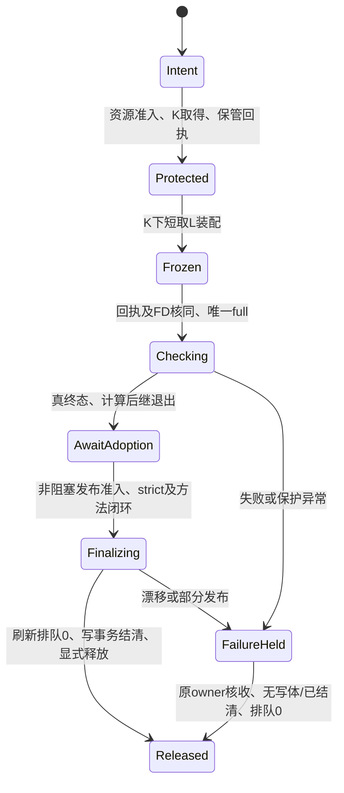

# #68 锁协议与分账冻结方案（待主管批准）

状态：**仅方案，未实施、未修改 trusted 策略或控制。** 依据 [主管排期6525036281](https://github.com/dwroy/agent-sts2/issues/68#issuecomment-6525036281) 和 [知识发布分账要求6487050723](https://github.com/dwroy/agent-sts2/issues/68#issuecomment-6487050723)。优先级P1，工程排在#56学习并发之后、#71之前；不把本方案当当前#81空窗的采用批准。

建议采用“批次级K保管 + 代码/知识双回执 + 可续下载边界让槽”。先实现K闭环和资源优先级，再接分账冻结；每批按原工程队列检查、核收后开启，旧事务不转换。

## 1. 已核事实和本轮范围

- 当前可信 `board_queue_checks.run` 在 `source_locks` 中装配，退出该上下文即放K/L，再执行tsc、host、consumers/full。缺少“保管K已生效”这道启动屏障。现有#82/#83/#81保护空窗分别约62.8/100/883.789秒；这些是原回执窗口，不代表本轮重新测量。见 [82采用边界](https://github.com/dwroy/agent-sts2/issues/82#issuecomment-6513930571)、[本次排期](https://github.com/dwroy/agent-sts2/issues/68#issuecomment-6525036281)。
- 2026-10-30读取的main为`1b7c652cbd5ef2355687e1e159fccacb2a73da06`。原#81独立检查点仍记录full在途、ops持K保护余窗；本开发不接管该事务或推断其后终态。
- 10/27交付`f88c5b4e7`不是当前trusted能力。其首次队列在full前因部署映射拒绝，后继归一树待排期；不能据开发定向测试直接采用它的刷新例外。[原集成更正](https://github.com/dwroy/agent-sts2/issues/68#issuecomment-6459294375)
- K1是正式知识版本；D1是固定producer统计/模型数据版本。catalog、兼容文件和未迁移刷新输出又有各自写入来源。`knowledge/`前缀不能证明某叶有K1回执。#84已经上线的是逐producer真实方法闭包、同次发布CAS准入和恢复回执，不是给所有知识文件豁免。[#84结案及闭环](https://github.com/dwroy/agent-sts2/issues/84#issuecomment-6523542466)

本轮只交方案、证据索引和主管收件箱一行。不改变K/L/full、生产队列、methods、数据指针、账号/并发/1或2槽容量、游戏或STOP，不运行测试/full、取消任务或启动保管进程。

## 2. K交接自动化

### 2.1 原队列启动批次保管，先保护再冻结

每个新批次由原唯一minute/队列启动一个**批次级K保管者**，替代原ops手工持K helper；不新增常驻daemon、cron、监听模型或第二tick。每项目最多一个未结保管epoch。保管者只做锁/回执和既定状态推进，没有main/LIVE源码写资格。

1. 在项目刷新准入处登记`refresh_hold_epoch`与本批身份。新普通刷新请求先持久记为deferred/debt，不能先占heavy槽再等K。原来已启动的计算/写事务正常结算；未知旧入口不签已排空。
2. 合并worker先按原机器协议获得资源；非阻塞取得K。K忙即归还本次临时取得的锁/资源、按原入口等待，不持业务锁等机器位。登记/等待状态必须由新版本合同表达，不能手改attempt或max_attempts。
3. K由保管者持有到终态；worker通过已认证本地通道借用**同一open-file-description的FD**，不采用“关旧K、再开同名文件重取”的接力。借用不会额外flock同inode而自等。保管者只继承K和控制通道，主动关闭heavy/queue/full FD，避免full结束后仍占计算槽。
4. worker在已保护K下短取L并装配。持久回执绑定root、batch/request revision、candidate、baseline、policy/kit、epoch/token、boot、保管者/worker PID及birth、K dev/inode/实际FLOCK、连续取得时刻和快照SHA。原子落盘并fsync后双方确认；环境字符串、路径存在或“已发提醒”不算回执。
5. **只有回执与实际FD都核同才允许创建full.once和启动full。** 建议握手上限30秒，超时留`waiting/failed-before-full`实际阶段和full_runs=0；具体等待/超时结果随新队列合同固定，不伪造重试。full启动后保K回执持续有效，资源/FD沿原exec及Node子进程闭包传递。
6. full真实终态、原计算后继全部退场后归还heavy槽；K保管者转为轻量`awaiting-adoption`，仍持K直到strict采用/发布必要结算，或明确失败终态。该轻量身份须由可信probe精确识别，不冒旧计算、不漏计实际重任务；此识别要随新合同核收。

原队列须识别“检查结束但K事务未结”，不能因worker退出就静默丢保管记录，也不能另封一个相争的项目批次。保管者不是heavy计算；共享kit的生命周期/探针若需扩展，由原owner交新固定pin，项目不热补安装。

### 2.2 最终交接保持K连续，不再放K后追strict

原publication owner准备好接续后，先核本批回执，再按下节原顺序非阻塞取发布锁；通过授权借用同一K FD进入strict。保管者持续持K，**strict不会经历一次实际unlock窗口**。这替换“同一分钟放K后再抢回”的人工竞速，不降低原逐字节核验。

只有实际strict/必要发布结算成功，或明确失败且未留下不明写体，并完成刷新排空证据后，owner发带epoch/CAS的release确认；保管者核所有K借用者/后继已退场才关最后一个FD。成功回执、release确认、kernel释放分列。shadow仅结算shadow结果，不据此签main独占或生产上线。

### 2.3 放K前排队0与等同排队取消

采用 [77/6496035933](https://github.com/dwroy/agent-sts2/issues/77#issuecomment-6496035933)、[82/6511764132](https://github.com/dwroy/agent-sts2/issues/82#issuecomment-6511764132) 的精确条件，作为代码判定，不用角色名或elapsed猜测。

| 状态 | 自动处置所需全部证据 |
| --- | --- |
| queued、无slot | 同root/命令与参数SHA、原request/控制绑定；无计算子进程、无写事务/半截回执，仅自身machine lease |
| running但仅等K | 上述身份核同；wchan及内核等待箭头都指向原K；一次性`flock -F`启动链/新增取得日志证明从未拿K；实际命令未启动、无子进程/本PID刷新段，无D1 attempt/release或共享写事务；只持自己的lease和slot |
| 已拿K、已有计算/写事务、身份未知 | 不自动取消，保留原执行/失败，回具体owner和阻碍 |

自动取消只适用于已经裁定的普通无逐局参数`--all`、成本、漏斗三类；还须核选项、角色、源根、控制/方法、固定截止线等覆盖关系，命令相同不能掩盖不同冻结研究/输入。显式cutoff/专题/校准或不能证明可覆盖的请求保留。历史无足够身份/“从未取得K”证据者不补造日志。

先持久写取消意图和补跑债务，再对核定PID/birth发TERM，等待实退、slot/claim释放；不用KILL、pkill，也不把“已发TERM”当取消完成。状态变了即撤销该次自动处置。原请求仍记取消，不写成published/succeeded。

刷新准入屏障保持关闭时，在原项目/机器队列守卫下核全入口集合：queued、仅等K、admission-inflight、未结claim和未知项均为0；活跃计算另须实退/已结清。将队列epoch和PID/birth/锁证据落盘。检查到放K/交接之间的新请求只能进入deferred账，不得穿入heavy。这里“排队0”不是只看本角色或只看queued字段，也不要求deferred补跑债务为0。

采用或明确失败结算后，按原入口新ID顺序补`all一次 → 成本一次 → 漏斗一次`，保原取消alias及完整债务账，逐项以真实终态收债。原截止线/源被轮转而覆盖关系不明则保pending，交owner，不宣称补跑已覆盖。已published/D1完成的原request不重算；补跑必须使用实际安装且已准入的方法，不把旧请求热绑新方法。

## 3. 代码叶与知识叶分别冻结

### 3.1 分类以实际能力和来源为准

| 冻结类 | 范围和规则 |
| --- | --- |
| CodeSeal | 代码、schema/验证器、工程配置、#84方法声明/闭包、固定夹具、依赖/工具、精确部署目标；路径/bytes/mode/来源及candidate/main CAS严格不变 |
| K1 DataSeal | 显式映射的正式知识叶；冻结逻辑runtime、K1版本、完整manifest及原发布/完成事件；变化只能按下述已提交回执证明 |
| D1 DataSeal | 原managed_paths与D1 manifest/对象、producer、method及source cut；单列原回执，不能套K1规则；初版仍沿原K/D1写入合同 |
| 未迁移/未知 | 原严格前像；没有可信回执或映射就拒绝，不能因位于knowledge/或扩展名JSON而放行 |

同一路径若也是CodeSeal、fixture、方法输入或候选显式目标，**严格类优先**。`knowledge/builders/*.py`、工程依赖声明不是知识数据。代码批夹带知识写入不得混进这个例外，按原混合/知识发布入口处理。

CodeSeal不再对整个LIVE工作目录总hash一刀切。Git HEAD/tree/index保留为独立审计和源码CAS证据；本版K1权限不包含修改main、LIVE HEAD或index。Git元数据变化、代码叶/mode变化仍拒绝，不能用数据回执解释任意Git提交。

### 3.2 K1回执如何核，如何允许在途知识发布

1. assembly先固定CodeSeal和其实际读取的K1/D1版本、数据叶前像、schema/消费者能力与检查读集合。full跑固定W/G和不可变快照，不读“latest LIVE”。代码叶摘要与DataSeal分别保存，数据新版本不覆盖原证据。
2. 对后继物理知识叶差异，从**原runtime API/只读一致读事务**核真实`releases/release_files/events/knowledge_completions`及不可变snapshot/manifest，回到原发布链和CAS parent。单独JSON回执、“published”字样或只核K1格式都不够；事务未commit、回执丢失但未恢复核实、库/根/角色/对象缺失均拒绝。
3. 项目显式声明`LIVE兼容路径 → K1文档路径/合法写入口`。每一差异必须由同一逻辑runtime的已提交版本和原物化回执解释，当前字节/mode及manifest逐叶相同；继承未改叶也要从完整manifest核，不以候选仅列changed files充数。记录实际物化版本，不冒latest或自然采用。67项原异常必须先逐叶归为K1/D1/未迁移，不能先假定67项全有K1覆盖。
4. K1快照/DB短CAS发布本身不写代码或LIVE兼容文件，沿原事务可与代码full并行。需要落LIVE兼容文件的原owner，须在K1事务已提交并释放DB写事务后，带精确receipt/path permit经本批保管协议借K，短取L完成**仅这些知识叶**的原子物化及journal；不能借K写源码。无原物化入口者不新造第二writer，先交原K1 owner补明确接线。legacy无回执刷新仍被K挡住。
5. 来源回执不代消费者兼容性。候选已声明读这些路径的检查在新不可变数据视图做受影响补验，保旧full计数；纯代码/固定fixture检查复用原CodeSeal结果。读集合算不出、schema不兼容、与目标/方法输入重叠、补验失败则拒绝或待原owner补证，不把未知集合当空集。可复用10/27方案已测思路，但f88源码/策略仍需独立核收，不能直装。
6. 采用前关闭本批知识物化permit，等待已授权物化短事务结束，在原strict锁域再核CodeSeal及实际DataSeal；DB可产生后继已提交K1，但未经本次物化的版本不伪称已写LIVE。版本读取始终固定，不读取一半manifest/对象。需要的新数据补验在短写体前完成，再漂移只续DataSeal验证，不自动重full。

新数据证据包括：原/新版本、receipt及DB事件身份、source/manifest/实际叶SHA、允许差异、受影响检查及结果、旧code/full回执指针、最终采用线性点。知识、科学效果及原运行绑定另账；旧局/旧学习批的K1/D1不热切。无回执改写照旧拒绝，不能把本机制做成“全knowledge忽略”。

## 4. 锁顺序与#84闭环

资源准入/下载让槽在所有业务锁之外。以下均非阻塞取新锁；忙即放本次临时锁并回原入口，不持L/数据锁等K、机器位或全局学习锁。R为短刷新准入元数据屏障，只保护登记/排空epoch，**不包计算、网络、子进程或其他业务锁调用**。

| 路径 | 顺序/持有范围 |
| --- | --- |
| 检查装配 | 原机器准入 → 唯一full门 → 批K保管确认 → L短装配；释放L，K由保管者跨检查续持；full门只服务原唯一检查 |
| strict/源码发布 | 原`learn → game-admission → 借用本批K → L → 原D1 publication非阻塞门`；按#57既有时点释放learn/game后执行写体，K保管持续。不能让同一任务重新open/flock自己的K |
| K1独立发布 | 沿原K1候选/审阅和SQLite短CAS事务；不从DB事务反向等K/L/learn，DB提交后才准备兼容物化请求 |
| K1兼容物化 | 已提交K1回执/permit → 借本批K → L短写；不借机写方法/control/code；strict开始前收束这些permit |
| D1固定刷新 | 保原K/producer/D1 journal与锁合同；初版不开放其穿越代码保管K。不得把其data-publication锁换成K1证明 |
| 最终放K | 结算写事务/借用者 → R屏障下新鲜全队列0回执 → 原owner release CAS → 最后K FD关闭 → 开刷新准入/原债务顺序补跑 |

“借K”是新协议的明确委托路径：保管者永不请求learn/game/L；borrower仍先过原learn/game门，并只接受已验证的同一OFD能力，不能阻塞等控制通道。拿不到permit/FD就释放临时锁重排。它需要修改原`source_locks/publication_gate`受控入口；不是把当前锁序倒过来，也不是从另一个flock子进程重取同锁。

实际部署子进程也须显式继承已核K/L、适用数据锁及机器资源FD，登记PID/birth和退出；不能沿当前`close_fds=True`把受托保护丢在父进程。父退出、子仍写入时保持锁/事务未结，不由另一个owner恢复或重复部署；全部实际写体后继退场才允许原事务核收。只传本事务所需FD，不把token或全环境写进公开证据。

#84保持原工程闭环：新batch受测ROOT/LIVE来源 → `fixed_method_admission.prepare`材料 → 原`publication_gate.write`精确部署/安装核验 → `control.methods`前像CAS → 持久方法事务 → `verify_release`。发布D1锁忙则保原事务重排，不能用K1数据绿灯跳过方法门。

只改K1内容不会改CodeSeal/producer闭包；确实改变producer/validator/opaque callsite/声明时，必须带该次工程材料。旧D1继续保原method与source cut，不因登记新method就算重算；后继补跑用新request核实际已安装方法。#84崩溃在部署后或CAS后未落回执，仍沿同一事务`resume-fixed-methods`，不给第二部署argv；缺回执/未知安装状态不能release。

## 5. 资源优先级和下载边界

仅新增已裁定偏序：**合并批assembly至full真实终态 > 后台全量下载**；不重排未获授权的ops恢复/学习等级，不改#56实际已批学习并发或heavy的1/2容量。游戏仍只声明、不占heavy槽，继续运行。[82/6520247676](https://github.com/dwroy/agent-sts2/issues/82#issuecomment-6520247676)

- 分类来自可信入口/已登记request，不能由任务自称integrator或改issue优先级抢位。新合并请求使下载者收到`yield_requested`，在当前页完整处理、对象及cursor/墓碑统计持久化、原事务/子进程收尾后正常退出，释放原slot；不KILL、不丢半页、不把yield写为下载完成。
- 让槽回执保cycle/shard/page/cursor、已下对象SHA、墓碑分子/分母/比例、PID/birth和slot释放。无法证明checkpoint安全的CLI不自动抢占，交原owner边界续接。
- full终态且K保管交接确认后，若无更高合并批，原下载owner从原cursor继续；下一合并批到来再在下一安全页让。下载不许在K下等slot。待采用期间只可做不触碰K保护数据/代码的下载阶段，不能绕过方法或数据发布门。
- 因连续让槽24小时没有推进，原tick去重通知主管排期；不自动加槽、降方法门或停游戏。刷新债务与下载进度分账，不能用一次下载恢复代all/成本/漏斗补跑。

## 6. 失败、中断与恢复

| 情况 | 处置 |
| --- | --- |
| K忙、握手缺失/错epoch/错FD | full不启动；保实际等待/失败阶段与full0，不补绿、不清旧attempt |
| full非零、信号或缺结果 | 保旧full.once/日志，等本批实际后继退出；不自动重full；排空/债务核收后由原owner结算K |
| worker死但保管者活 | K继续持有，查原唯一result和真实后继，恢复同batch/token/CAS，不再开runner |
| 保管者死但worker仍持同K FD | 核同boot/PID/birth/OFD后由原owner接原epoch恢复保管；不中途unlock，不把重新取同路径当连续保护 |
| 所有K FD都丢失、连续性不明 | 明记保护丢失，禁止自动采用；不凭“现在零漂移”补全过去，交原owner按当时批准合同处置；不暗启第二full |
| 未知刷新/不能取消、队列仍非0 | 保K及具体阻碍，原tick去重告警；不按TTL自动unlock、不伪造0；原owner裁定安全结算 |
| strict发现无回执/目标相交/源码漂移 | 拒绝，保原代码检查和数据拒绝证据；明确是否只缺DataSeal，不能抹原失败或自动放宽 |
| 部分代码/方法写入、CAS含糊 | #84/#57原事务resume/核实际后像，保持发布门和K；先补已成功回执，禁重放部署 |

恢复一律核root/batch/revision/epoch、boot、PID start、kernel FD和原journal SHA；PID复用/旧token失效。full计算后继确认退出之前不得把保管进程误认为“只有轻量控制”并提前归还计算资源。owner异常时既有发布门继续fail-closed；本方案不创建/删除STOP、PAUSE或旧全局门。

## 7. 分工、排期与验收

| 批次 | 拟实现范围 | 负责人/验收 |
| --- | --- | --- |
| 批1：K与资源闭环 | 项目`board_queue_checks`、待增K保管/刷新hold与债务模块、`board_heavy/resources`、原刷新/成本/漏斗/下载边界、publication_gate委托入口；kit生命周期/任务偏序若需改由原共享owner出完整新pin | #68项目适配；共享owner负责通用引擎；原集成独核；ops下一新事务启用 |
| 批2：双Seal | 项目能力/知识路径映射、K1 receipt verifier、原K1物化入口、受影响读集合/隔离补验、#84证据兼容 | #68与原K1/#84接口owner串行；不恢复或另派已释放开发UI来重复开发 |
| 运行验收 | 原唯一minute下一真实新批，全程K、真实K1提交与拒绝坏来源、下载让槽与恢复、债务补跑/#84方法release读回 | 原ops/集成负责；准备、工程、运行及科学效果分账 |

批1先解决人为保护空窗和资源阻塞；批2才修改冻结语义。源码/配置增量全部走原固定交付/正常队列，未部署能力保持off；现有在途批/旧publication marker沿原合同结算。主管批准本方案前，不修改trusted checker/策略或共享kit、不借本排期转换旧#81。

必要固定测试：K在assembly后到full前守卫崩溃/错回执不启动、真实FD跨exec/fork及无槽泄漏、worker/保管者分别崩溃、取消判定每一条件缺失及PID复用、R屏障新入队竞态与0回执、债务去重/三项补跑、K1正确链放行/伪回执及D1冒K1拒绝/漏叶及目标相交拒绝、代码/fixture/依赖漂移、数据期间再发布的有界补验、下载页内不抢/页边让槽/原cursor墓碑不变、#84缺材料/安装前像冲突/CAS后崩溃恢复。测试只用固定数据；最终匹配组合唯一full，不重复已有有效检查。

实际验收须分别给出：`K_held_at ≤ assembly_sealed_at < full_started_at`的真实FD/时间证据，直到strict终态K连续；放K前全部活动/等待为0且deferred债务保留；每次知识差异有权威版本与物化SHA，原full次数不因合法数据推进增加；方法准入闭环仍能挡漏声明；至少一次下载真实页边让槽与续cursor。未自然出现的场景记pending，不强开局/模型制造样本，不关闭学习/科学父。

请主管批准：以上优先级与“批1 → 批2”分批、同OFD保管/委托K合同、K1闭集回执例外及D1不混用、合并批高于下载的边界调度。批准后#68据实际最新源码再冻结实施清单；此文件和收件箱通知均不是实施/切换回执。
